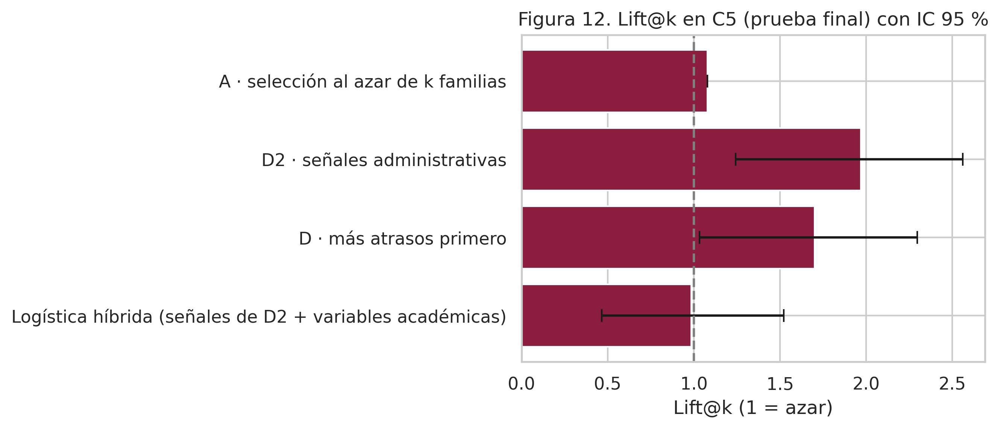
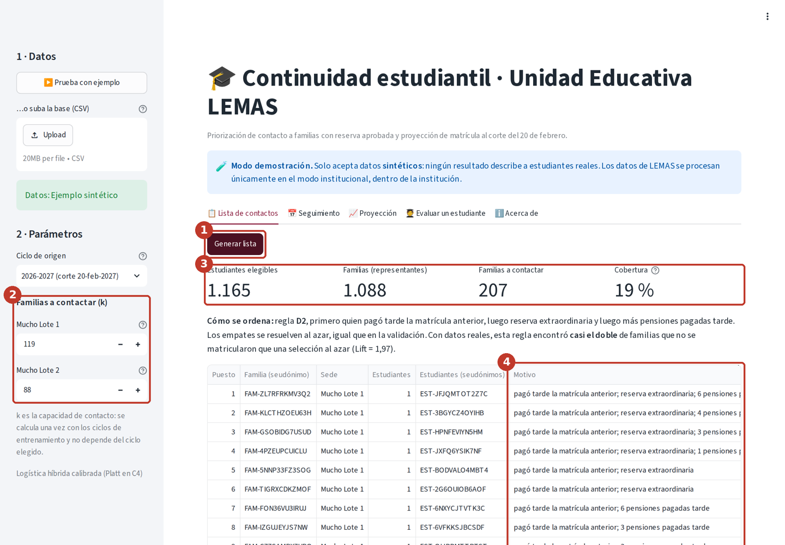
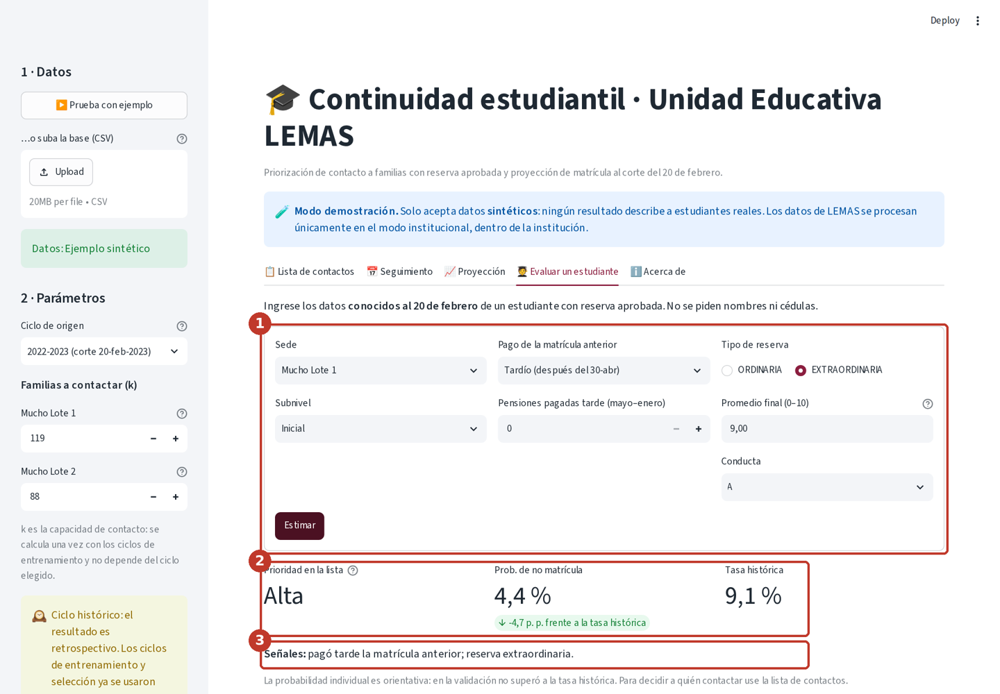
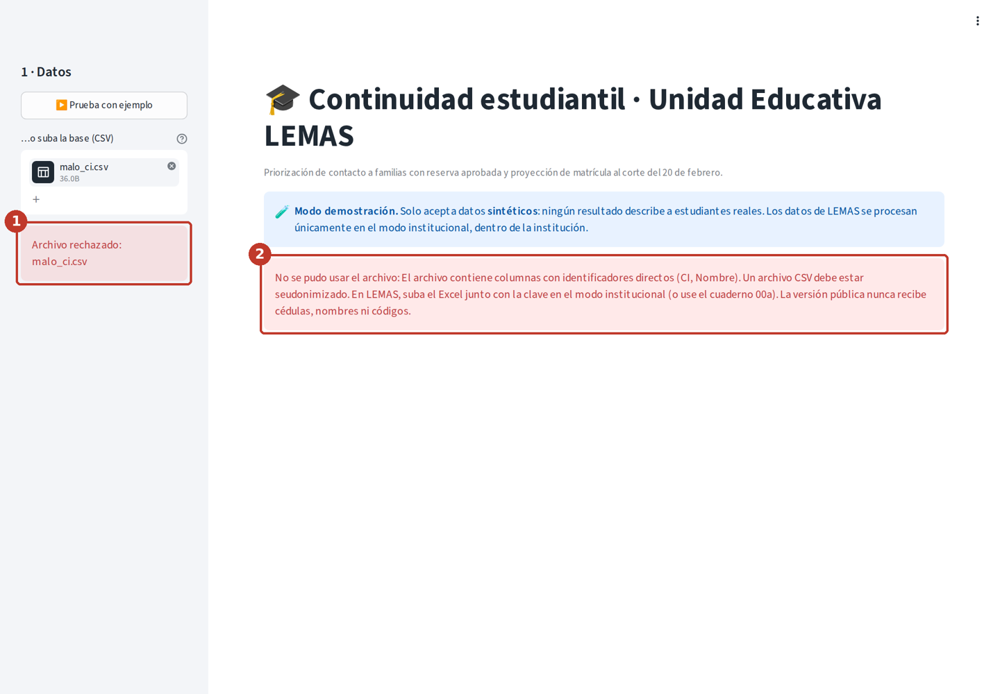

# Predicción de matrícula y continuidad estudiantil


[](https://github.com/ggranizo2507/prediccion-matricula-lemas/actions/workflows/tests.yml)


Sistema de IA que identifica, al **20 de febrero** de cada año, a las familias con reserva aprobada que podrían **no concretar la matrícula** antes del **30 de abril**. Entrega a Secretaría y Admisiones de la Unidad Educativa LEMAS una lista priorizada de contactos ajustada a su capacidad real y una proyección de matrícula por sede y subnivel. En la prueba final con datos reales, la priorización encontró **casi el doble** de familias que no se matricularon que una selección al azar (Lift@k = 1,97, IC 95 % [1,24; 2,56]).

🔗 **Aplicación (demo con datos sintéticos):** [continuidad-matricula-lemas.streamlit.app](https://continuidad-matricula-lemas.streamlit.app/)

[](https://continuidad-matricula-lemas.streamlit.app/)

> Proyecto integrador · Maestría en Inteligencia Artificial · Universidad de Especialidades Espíritu Santo (UEES), 2026.

## Tabla de contenidos
1. [Descripción del problema](#descripción-del-problema)
2. [Dataset](#dataset)
3. [Metodología](#metodología)
4. [Resultados](#resultados)
5. [Instalación y uso](#instalación-y-uso)
6. [Interfaz de usuario](#interfaz-de-usuario)
7. [Estructura del proyecto](#estructura-del-proyecto)
8. [Consideraciones éticas](#consideraciones-éticas)
9. [Autores y contribuciones](#autores-y-contribuciones)
10. [Licencia](#licencia)
11. [Agradecimientos y referencias](#agradecimientos-y-referencias)
12. [Videos](#videos)

## Descripción del problema
Cada año, entre septiembre y noviembre, las familias de LEMAS reservan un cupo para el ciclo siguiente. No todas las reservas aprobadas terminan en matrícula pagada. Cuando una familia no continúa, la institución se entera tarde, sin tiempo para ofrecer apoyo ni para planificar cupos, docentes y paralelos.

**Qué resuelve.** El modelo ordena a los estudiantes elegibles por su riesgo de no matricularse y consolida el resultado por representante. Así, las 10 personas de Secretaría y Admisiones de las dos sedes concentran su tiempo en las familias que más lo necesitan.

**Por qué importa.** Contactar a tiempo permite ofrecer planes de pago, información de becas o atención a inquietudes, y proyectar la matrícula con anticipación.

**Usuarios objetivo.** Secretaría, Admisiones y Dirección de LEMAS.

## Dataset
| Aspecto | Detalle |
|---|---|
| Fuente | Registros institucionales de LEMAS, ciclos 2021–2022 a 2026–2027 |
| Unidad | Estudiante antiguo con reserva aprobada para el ciclo siguiente |
| Tamaño | 9.031 registros (estudiante × ciclo) de 2.733 estudiantes y 2.017 representantes; 6.361 estudiantes modelables en cinco cohortes (C1 a C5) |
| Cohortes | C2–C3 entrenamiento, C4 selección y C5 prueba final evaluada una sola vez. C1 se excluyó en la auditoría de comparabilidad (D14) |
| Variables | Sede, subnivel, curso, años de permanencia, promedio, conducta, beca, pensiones pagadas tarde, tipo de reserva, hermanos en LEMAS, puntualidad de la matrícula anterior |
| Etiqueta | 1 = no pagó matrícula entre el 20-feb y el 30-abr del año de destino (8,3 % de los casos: clases desbalanceadas) |
| Licencia y acceso | Datos **propiedad de LEMAS**, usados con autorización institucional para este estudio; no son públicos ni se redistribuyen. La base sintética de `data/synthetic/` se publica bajo la licencia MIT del repositorio |

**Privacidad.** Los datos reales contienen información de menores y **no se publican**. Se seudonimizan con HMAC-SHA256 y clave custodiada por LEMAS (`tools/seudonimizar.py`), y se procesan solo en el entorno autorizado. Este repositorio incluye un **dataset sintético** (`data/synthetic/`) con la misma estructura, calibrado únicamente con totales agregados. Sirve para ejecutar el código, **no** para sacar conclusiones sobre LEMAS. Detalle en [`data/README.md`](data/README.md).

## Metodología
- **Enfoque:** clasificación binaria supervisada con validación temporal por cohortes.
- **Candidatos:** regresión logística elastic-net, gradient boosting (HistGradientBoosting con monotonía en atrasos) y una logística híbrida, comparados contra reglas sin IA (D: más atrasos primero; D2: señales administrativas) y las líneas base del v5 (A, R, B0, B1).
- **Preprocesamiento:** limpieza, derivación de variables conocidas en t0 y guardas automáticas anti-fuga (`src/data_processing.py`).
- **Auditoría de datos:** conteo de eventos de no matrícula por cohorte y comparabilidad de C1. Se entrena con y sin C1, se evalúa en C4 y C1 se incluye solo si no degrada la priorización (`src/auditoria.py`).
- **Optimización:** Optuna (TPE, 60 trials por modelo) con validación interna temporal C2 → C3; selección en C4; calibración de Platt; sistema congelado (SHA-256) y prueba única en C5. Ver [`docs/optimizacion.md`](docs/optimizacion.md).
- **Métricas:** Precision@k y Lift@k por sede (métrica principal, con k igual a la capacidad de contacto), Recall@k, PR-AUC, ROC-AUC, Brier e intervalos bootstrap por familia. **No se reporta exactitud ni F1:** con 8,3 % de casos, decir «todas se matriculan» acierta el 92 %, y la lista no usa un umbral sino un número fijo de llamadas ([`docs/evaluacion_robusta.md`](docs/evaluacion_robusta.md) §3).
- **Análisis de sensibilidad de hiperparámetros:** importancia por fANOVA, dependencia parcial e interacciones sobre las 180 pruebas de Optuna (D58).
- **Robustez:** escenarios críticos con datos dañados a propósito (errores de registro, faltantes, desbalance, cambio de distribución y señal caída) sobre C4 ([`docs/escenarios_criticos.md`](docs/escenarios_criticos.md)).

## Resultados
Prueba final en **C5** (matrícula 2026–2027), evaluada **una sola vez** con el sistema congelado. k = 118 familias en Mucho Lote 1 y 47 en Mucho Lote 2 (≈ 15 % de 1.093 familias). Solo cifras agregadas.

| Sistema | Precision@k | Lift@k [IC 95 %] | Recall@k |
|---|---|---|---|
| **D2 · señales administrativas** (solución elegida) | **0,133** | **1,97 [1,24; 2,56]** | **0,30** |
| D · más atrasos primero | 0,115 | 1,70 [1,03; 2,30] | 0,26 |
| Logística híbrida (mejor modelo de ML en C4) | 0,067 | 0,98 [0,47; 1,52] | 0,15 |
| A · selección al azar | 0,073 | 1,08 | 0,16 |

- **Hallazgo principal:** contactando al 15 % de las familias se llega al **30 %** de las que no se matriculan. La regla D2 (pago anterior tardío → reserva extraordinaria → pensiones pagadas tarde) se definió en la Fase 1 a partir del análisis exploratorio y se confirmó en C5 sin ajustar nada. **Ese análisis exploratorio usó las cinco cohortes**; al repetirlo solo con C1–C3, el orden de las señales sale igual, así que D2 se habría construido igual sin ver C4 ni C5. Dos matices: D2 y D son estadísticamente indistinguibles (diferencia en C4 de 0,00 [−0,62; 0,62]) y el Lift@k depende del sorteo de empates (media de 1,77 en C4 con 500 sorteos) (D59, [`docs/modelado.md`](docs/modelado.md#9-comprobaciones-de-la-revisión-final-d59)).
- **Los modelos de aprendizaje automático no superaron a la regla** con 193 eventos de entrenamiento: el gradient boosting se sobreajustó y los modelos lineales se quedaron cortos. Es un resultado válido y está documentado.
- **Calibración y proyección:** la logística híbrida calibrada iguala a la tasa histórica (Brier 0,0648 frente a 0,0647; MAPE 2,8 % en ambos).
- **Equidad:** menor detección en familias becadas (recall 0,18 frente a 0,32), que se advierte en la app.



Detalle en [`docs/analisis_datos.md`](docs/analisis_datos.md) y [`docs/modelado.md`](docs/modelado.md).

## Instalación y uso

### Opción A · Google Colab (recomendada para el equipo)
Cada notebook trae una celda **0 · Preparar el entorno**. Esa celda clona el repositorio (o pide subir el `.zip`) e instala solo lo que falte.

| Notebook | Qué hace | Abrir |
|---|---|---|
| `00a_seudonimizacion` | Excel de LEMAS → `base_seud.csv` seudonimizado (solo personal autorizado) | [](https://colab.research.google.com/github/ggranizo2507/prediccion-matricula-lemas/blob/main/notebooks/00a_seudonimizacion.ipynb) |
| `00b_perfil_datos` | Perfil agregado para calibrar el sintético | [](https://colab.research.google.com/github/ggranizo2507/prediccion-matricula-lemas/blob/main/notebooks/00b_perfil_datos.ipynb) |
| `01_exploracion` | EDA con 8 figuras a 300 DPI, conteo de eventos por estudiante y representante, y comparabilidad de C1 (SMD) | [](https://colab.research.google.com/github/ggranizo2507/prediccion-matricula-lemas/blob/main/notebooks/01_exploracion.ipynb) |
| `02_preprocesamiento` | Partición temporal, anti-fuga, transformaciones y decisión de incluir C1 (evaluada en C4) | [](https://colab.research.google.com/github/ggranizo2507/prediccion-matricula-lemas/blob/main/notebooks/02_preprocesamiento.ipynb) |
| `03_modelado` | Optuna (regresión logística y gradient boosting), selección en C4 frente a las reglas D/D2, calibración, SHAP, congelamiento y prueba final única en C5 con IC bootstrap, equidad y proyección | [](https://colab.research.google.com/github/ggranizo2507/prediccion-matricula-lemas/blob/main/notebooks/03_modelado.ipynb) |
| `04_optimizacion` | Análisis de la búsqueda con Optuna (180 trials), efecto de hiperparámetros, paso de C3 a C4 y diagnóstico de ajuste. Lee resultados guardados; no reentrena | [](https://colab.research.google.com/github/ggranizo2507/prediccion-matricula-lemas/blob/main/notebooks/04_optimizacion.ipynb) |
| `05_evaluacion` | Resultados de la prueba única en C5: IC 95 %, Brier frente a R/B0/B1, criterios del Canvas, explicabilidad, equidad y proyección. Lee resultados guardados | [](https://colab.research.google.com/github/ggranizo2507/prediccion-matricula-lemas/blob/main/notebooks/05_evaluacion.ipynb) |
| `overfitting_analysis` | **Actividad de la semana 3:** seguimiento de métricas, curvas de aprendizaje (pérdida y PR-AUC por iteración, por tamaño de datos y por hiperparámetro), diagnóstico de sobreajuste y subajuste (con la segunda etapa: falta de capacidad o límite de señal), y siete estrategias limpias con antes/después, intervalo bootstrap, réplica C2 → C3 y cinco semillas (D54). No usa C5. Se guarda ejecutado, con sus salidas | [](https://colab.research.google.com/github/ggranizo2507/prediccion-matricula-lemas/blob/main/notebooks/overfitting_analysis.ipynb) |
| `06_alcance_lista` | Por qué la lista no llega a más familias: qué hay dentro del evento (paga tarde, paga en parte o no registra ningún pago), alcance según el número de contactos y lista fija frente a lista semanal. Descriptivo; no usa C5 | [](https://colab.research.google.com/github/ggranizo2507/prediccion-matricula-lemas/blob/main/notebooks/06_alcance_lista.ipynb) |
| `07_escenarios_criticos` | **Workshop de escenarios críticos (semana 5):** errores de registro, datos faltantes, desbalance extremo, cambio de distribución y señal caída sobre C4, con el sistema ya elegido y límites operativos (Lift@k ≥ 1,20). No usa C5 | [](https://colab.research.google.com/github/ggranizo2507/prediccion-matricula-lemas/blob/main/notebooks/07_escenarios_criticos.ipynb) |
| `08_revision_final` | **Comprobaciones de la revisión final (D59):** orden de las señales de D2 solo con C1–C3, distribución del Lift@k con 500 sorteos de desempate, IC 95 % de la diferencia D2 − D, azar por estudiante frente a azar por familia y estadísticos descriptivos. No usa C5 salvo que se marque `INCLUIR_C5` | [](https://colab.research.google.com/github/ggranizo2507/prediccion-matricula-lemas/blob/main/notebooks/08_revision_final.ipynb) |

En los notebooks 01, 02, 03, 06, 07 y 08, el parámetro `FUENTE` elige entre `sintetica` (cualquier persona) y `real` (solo en el entorno autorizado de LEMAS). Los notebooks 04 y 05 leen los **agregados reales ya publicados** en `results/` (autorizados por LEMAS), así que cualquier persona puede ejecutarlos.

> ⚠️ **Qué se puede reproducir fuera de LEMAS.** Con la base sintética se reproduce **el código** (todas las pruebas, todos los cuadernos y la aplicación), no **las conclusiones**. La base sintética respeta los totales por cohorte, pero sus relaciones entre variables son supuestos del generador: con ella, el cuaderno 03 concluye que la logística híbrida supera a D2, al revés que con los datos reales. Los resultados reales no son reproducibles fuera de LEMAS por diseño (datos de menores, LOPDP). Su evidencia es indirecta y verificable: las salidas agregadas de los cuadernos 04, 05, 07, 08 y `overfitting_analysis` ejecutados con `Fuente: real`, el SHA-256 del sistema congelado (`results/metrics/resultados_finales_real.json`) y el registro de decisiones fechadas ([`docs/planificacion.md`](docs/planificacion.md)).

### Opción B · Entorno local
```bash
git clone https://github.com/ggranizo2507/prediccion-matricula-lemas.git
cd prediccion-matricula-lemas
python -m venv .venv && source .venv/bin/activate   # Windows: .venv\Scripts\activate
pip install -r requirements.txt                     # versiones exactas

python -m src.synthetic --parametros data/synthetic/parametros_calibracion.json  # regenera la base sintética publicada (idéntica)
python -m src.data_processing                        # construye la tabla de modelado
pytest -q                                            # ejecuta las pruebas
```

## Interfaz de usuario
Aplicación **Streamlit** en español (`app/app.py`), con **dos modos** (decisiones D42 y D45):

| Modo | Dónde | Datos |
|---|---|---|
| **Demo** (por defecto) | Streamlit Community Cloud | Solo **sintéticos**; rechaza archivos con identificadores o sin la marca de datos sintéticos |
| **Institucional** | Computador de LEMAS, solo `localhost` (doble clic en `iniciar_lemas.bat`) | El **Excel de LEMAS + la clave del custodio**: se seudonimiza en el propio equipo. También acepta `base_seud.csv`. Nada se guarda |

**Funciones:** botón *Prueba con ejemplo*; carga validada de CSV (rechaza cédulas o nombres); lista de contactos por sede con k editable, motivo de cada prioridad y descarga CSV; proyección por sede y subnivel frente a B1; pestaña *Seguimiento*, que a una fecha de corte lista a las familias que siguen sin pagar (D51; es un listado, no una predicción); formulario para evaluar a un estudiante; sección *Acerca de* con métricas, limitaciones y privacidad.

**Solo en modo institucional (D45):** carga del Excel institucional y de la clave, seudonimización en memoria con verificación automática, descarga de `base_seud.csv` y del acta, pestaña **Lista con nombres** para personal autorizado (los nombres también se pueden ver en *Seguimiento*, con la misma confirmación) y botón **Borrar datos de la sesión**. Así el personal de LEMAS no necesita Colab ni línea de comandos. La versión pública no tiene ninguna de estas funciones.

```bash
pip install -r app/requirements.txt
streamlit run app/app.py                          # demo
# Solo dentro de LEMAS: doble clic en iniciar_lemas.bat (Windows) o:
bash iniciar_lemas.sh                             # macOS / Linux
python tools/generar_excel_ejemplo.py             # Excel y clave FICTICIOS para practicar
```
**Capturas** (modo demostración, datos inventados):

| Lista de contactos con el motivo de cada familia | Formulario: prioridad y probabilidad | Manejo de errores |
|---|---|---|
|  |  |  |

**Cómo usarla:** 1) pulse **▶️ Prueba con ejemplo**; 2) revise k por sede; 3) pulse **Generar lista** y descárguela; 4) recorra *Seguimiento*, *Proyección*, *Evaluar un estudiante* y *Acerca de*. Las ocho capturas anotadas están en el manual.

Guía completa en [`docs/manual_usuario.md`](docs/manual_usuario.md) y diseño en [`docs/arquitectura.md`](docs/arquitectura.md).

## Estructura del proyecto
| Carpeta | Contenido |
|---|---|
| `data/` | `raw/` y `processed/` (vacías en el repositorio público) y `synthetic/` con la base artificial |
| `notebooks/` | 00a seudonimización, 00b perfil, 01 EDA, 02 preprocesamiento, 03 modelado (entrena, optimiza, calibra y evalúa una vez en C5), 04 optimización, 05 evaluación (análisis de resultados guardados), 06 alcance de la lista, 07 escenarios críticos y 08 comprobaciones de la revisión final, listos para Colab |
| `src/` | Código modular: `data_processing`, `auditoria`, `evaluate` (métricas por familia), `reglas` (D y D2, una sola definición), `modeling` (entrenamiento, Optuna, calibración, evaluación), `model` y `train` (puntos de entrada de la guía), `revision` (comprobaciones D59), `inferencia` (lógica de la app), `institucional`, `diagnostico`, `sensibilidad`, `alcance`, `costo`, `escenarios`, sus módulos de figuras (`graficos_*`), `synthetic` y `utils` |
| `tools/` | Seudonimización y perfil agregado (se ejecutan solo en LEMAS). Además, el reporte de diagnóstico, el costo esperado (`generar_costo.py`) la sensibilidad de hiperparámetros (`generar_sensibilidad.py`) y el resumen de resultados (`generar_resumen.py`), que solo leen tablas agregadas de `results/metrics` |
| `models/` | Sistema entrenado con datos sintéticos (los reales nunca se publican) |
| `app/` | Aplicación Streamlit, `requirements.txt` propio y recursos |
| `tests/` | 255 pruebas (`pytest -q`, también en GitHub Actions): datos, métricas, modelado, diagnóstico de ajuste, sensibilidad, alcance, costo, escenarios críticos, interfaz y modo institucional |
| `results/` | Figuras (300 DPI) y métricas **agregadas**, sintéticas y reales autorizadas; sin datos individuales |
| `docs/` | Planificación (con registro de decisiones), datos, arquitectura, optimización, ética y manual de usuario |
| `config.yaml` | Todas las reglas del estudio: cohortes, t0, H, filtros, capacidad, privacidad, umbrales y espacio de búsqueda de Optuna |

**Equivalencias con la estructura de la guía del curso.** Algunos nombres cambian porque el proyecto trabaja con datos de menores: el modelo entrenado con datos reales nunca se publica.

| La guía pide | En este repositorio | Motivo |
|---|---|---|
| `src/model.py` y `src/train.py` | Existen como puntos de entrada delgados: `model.py` reexporta la definición de los modelos y de las reglas, y `python -m src.train` entrena y compara en C4 sin abrir C5. La implementación está en `src/modeling.py` (modelos, Optuna, calibración, congelamiento) y `src/reglas.py` (D y D2) | Un solo módulo para definir, entrenar y congelar con el mismo protocolo temporal, sin duplicar código |
| `models/best_model.pkl` y `model_v1.pkl` | `models/sistema_sintetica.joblib` y `.json`, el sistema completo entrenado con la base sintética. El real (`sistema_real.joblib`) existe solo en LEMAS | Un modelo entrenado con datos reales puede memorizar casos; la solución final es la regla D2, que no necesita archivo de modelo |
| `tests/test_model.py` | `tests/test_modeling.py` (más otras nueve pruebas por módulo) | Mismo nombre que el módulo que prueba |
| `results/reports/` | [`resumen_resultados_real.md`](results/reports/resumen_resultados_real.md), generado desde las métricas (`tools/generar_resumen.py`). Los reportes en PDF ([`diagnostic_report.pdf`](docs/diagnostic_report.pdf) y el [workshop](docs/Workshop_Impacto_Social_y_Responsabilidad_LEMAS.pdf)) están en `docs/`; índice en [`results/reports/README.md`](results/reports/README.md) | Los PDF se entregan junto a la documentación que los explica |

### Documentación
| Documento | Contenido |
|---|---|
| [`docs/glosario.md`](docs/glosario.md) | Siglas y términos del proyecto (cohortes, reglas, líneas base, métricas y normas). Conviene leerlo primero |
| [`docs/planificacion.md`](docs/planificacion.md) | Problema, objetivos, alcance, cronograma planificado frente a real, riesgos y registro de decisiones D01–D59 |
| [`docs/analisis_datos.md`](docs/analisis_datos.md) | Análisis exploratorio, calidad de datos, auditoría de cohortes y referencias |
| [`docs/arquitectura.md`](docs/arquitectura.md) | Flujo de datos, componentes, solución elegida y aplicación en dos modos |
| [`docs/optimizacion.md`](docs/optimizacion.md) | Optuna, espacios de búsqueda, resultados, análisis de sensibilidad (importancia, dependencia parcial e interacciones), antes/después y diagnóstico de ajuste |
| [`docs/diagnostic_report.pdf`](docs/diagnostic_report.pdf) | Reporte técnico de la actividad de la semana 3: diagnóstico de sobreajuste y subajuste, curvas de aprendizaje y estrategias de mejora |
| [`docs/modelado.md`](docs/modelado.md) | Selección en C4, prueba final en C5, calibración, explicabilidad y equidad |
| [`docs/evaluacion_robusta.md`](docs/evaluacion_robusta.md) | Por qué validación temporal y no validación cruzada aleatoria; qué técnicas de incertidumbre y comparación aplicamos y cuáles no; costo esperado y razón de equilibrio de las llamadas |
| [`docs/escenarios_criticos.md`](docs/escenarios_criticos.md) | Evaluación en condiciones parecidas al uso real y simulación de escenarios críticos (errores de registro, faltantes, desbalance, cambio de distribución, señal caída) con límites operativos |
| [`docs/alcance_lista.md`](docs/alcance_lista.md) | El 70 % que la lista no encuentra: crítica del diseño, método de análisis y decisiones que puede informar |
| [`docs/consideraciones_eticas.md`](docs/consideraciones_eticas.md) | Principios y dilemas, sesgos, equidad, privacidad, explicabilidad, impacto social, responsabilidad, mal uso y cumplimiento normativo |
| [`docs/ficha_modelo.md`](docs/ficha_modelo.md) | Ficha del modelo (*model card*): uso previsto, métricas, resultados por grupo y límites |
| [`docs/hoja_de_datos.md`](docs/hoja_de_datos.md) | Hoja de datos (*datasheet*): origen, composición, recolección, limpieza, usos y distribución del conjunto de datos |
| [`docs/impacto_social_responsabilidad.md`](docs/impacto_social_responsabilidad.md) | Workshop de la semana 4: stakeholders, impacto social, riesgos éticos con su mitigación, responsabilidad, cumplimiento y compromiso del equipo. Versión entregada: [`Workshop_Impacto_Social_y_Responsabilidad_LEMAS.pdf`](docs/Workshop_Impacto_Social_y_Responsabilidad_LEMAS.pdf) |
| [`docs/manual_usuario.md`](docs/manual_usuario.md) | Uso de la app y procedimiento anual en LEMAS |
| [`docs/guion_pitch.md`](docs/guion_pitch.md) | Guion cronometrado del pitch (5 min) y plan de grabación |
| [`docs/banco_preguntas.md`](docs/banco_preguntas.md) | 49 preguntas probables de la defensa con sus respuestas, incluidas las de la revisión independiente |
| [`data/README.md`](data/README.md) · [`models/README.md`](models/README.md) | Diccionario de datos y modelos |

## Consideraciones éticas
El sistema **prioriza contactos de apoyo; no decide admisiones, reservas ni becas**, y la decisión final es siempre humana.
- **Privacidad:** seudonimización HMAC-SHA256 con clave custodiada, celdas menores a 5 suprimidas, app pública solo con datos sintéticos y repositorio sin datos reales.
- **Sesgos:** los atrasos son un proxy socioeconómico; la detección es menor en familias becadas; la cédula genérica de familias extranjeras no se usa como predictor.
- **Explicabilidad:** la regla D2 cabe en una frase y cada familia de la lista lleva su motivo. La importancia por permutación es coherente con la regla, y SHAP mostró que las variables académicas mueven la probabilidad sin mejorar el orden.
- **Responsabilidad:** LEMAS responde por el uso de la lista; el documento de ética define la cadena de responsabilidad, el plan de monitoreo y qué hacer ante un incidente.
- **Honestidad:** se informa que los modelos de ML no superaron a la regla y se reporta la incertidumbre.

**Limitaciones conocidas**
- Encuentra cerca del 30 % de los casos y no alcanza al 70 % restante. La lista tenía más cupos (165) que casos (74): es un límite de señal, no de capacidad. El análisis con C2 a C4 ([`docs/alcance_lista.md`](docs/alcance_lista.md)) muestra que el 86 % de los casos son familias que no registran ningún pago, que la regla solo ayuda las tres primeras semanas, que su Lift va de 1,4 a 2,0 según la cohorte y que hacia el día 35 quedan unas 200 familias pendientes por año, de las que el 44 % son casos.
- Con pocos eventos por grupo, la equidad no puede afirmarse con certeza.
- No se midió si la llamada cambia la decisión de la familia.
- Las familias aún no fueron informadas de este uso de sus datos. Antes de un uso operativo, LEMAS debe hacerlo, confirmar con su asesor la base legal para datos de menores y completar los pendientes de la ley ecuatoriana de protección de datos (LOPDP).
- Entre familias con el mismo puntaje, la lista se completa con un sorteo de semilla fija, igual que en la validación.

**Advertencias de uso**
- No usar para negar o condicionar cupos, reservas, becas o servicios, ni para cobranza.
- No usar con estudiantes nuevos, en otros colegios ni en otros procesos sin volver a validar.
- No subir datos reales a la versión pública, a GitHub ni a servicios externos.

Análisis completo en [`docs/consideraciones_eticas.md`](docs/consideraciones_eticas.md), resumen en la [ficha del modelo](docs/ficha_modelo.md) y en la [hoja de datos](docs/hoja_de_datos.md), y análisis de impacto social con el compromiso del equipo en [`docs/impacto_social_responsabilidad.md`](docs/impacto_social_responsabilidad.md).

## Autores y contribuciones
| Integrante | Rol |
|---|---|
| Guillermo Leonidas Granizo Veintimilla | Product Owner, dominio institucional, datos reales y validación con usuarios |
| José Farid Ulloa Manzur | Scrum Master, repositorio, modelado, optimización y aplicación |

## Licencia
Código bajo licencia [MIT](LICENSE). Los datos reales de LEMAS están excluidos.

## Agradecimientos y referencias
A la Unidad Educativa LEMAS por autorizar el uso seudonimizado de sus registros, y a la docente del curso por sus observaciones durante el semestre.

Referencias principales:
- Akiba, T. et al. (2019). Optuna: A next-generation hyperparameter optimization framework. *KDD 2019*.
- Pedregosa, F. et al. (2011). Scikit-learn: Machine learning in Python. *JMLR*, 12, 2825–2830.
- Lundberg, S. y Lee, S.-I. (2017). A unified approach to interpreting model predictions (SHAP). *NeurIPS 2017*.
- Hutter, F., Hoos, H. y Leyton-Brown, K. (2014). An efficient approach for assessing hyperparameter importance (fANOVA). *ICML 2014*.
- Platt, J. (1999). Probabilistic outputs for support vector machines and comparisons to regularized likelihood methods.
- Mitchell, M. et al. (2019). Model cards for model reporting. *FAT\* 2019*; Gebru, T. et al. (2021). Datasheets for datasets. *CACM*, 64(12).
- República del Ecuador (2021). *Ley Orgánica de Protección de Datos Personales*; UNESCO (2021). *Recomendación sobre la ética de la inteligencia artificial*.

La lista completa está en [`docs/consideraciones_eticas.md`](docs/consideraciones_eticas.md) (normativa, marcos y casos) y en [`docs/optimizacion.md`](docs/optimizacion.md) (métodos de optimización).

## Videos
*Se agregan en la Fase 4.*
- Video pitch (5 min): —
- Video de respuestas: —
