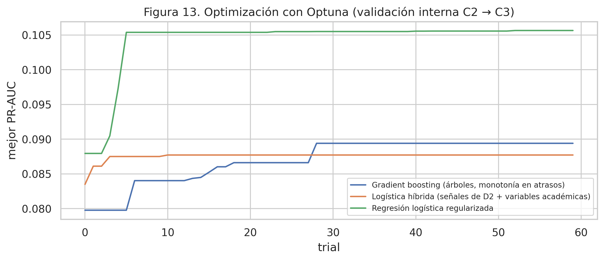
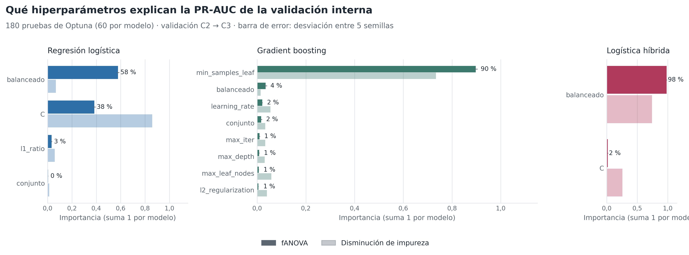
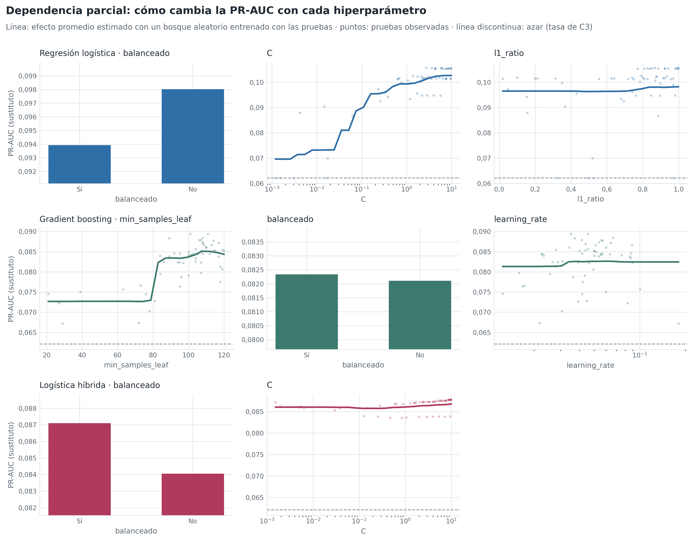
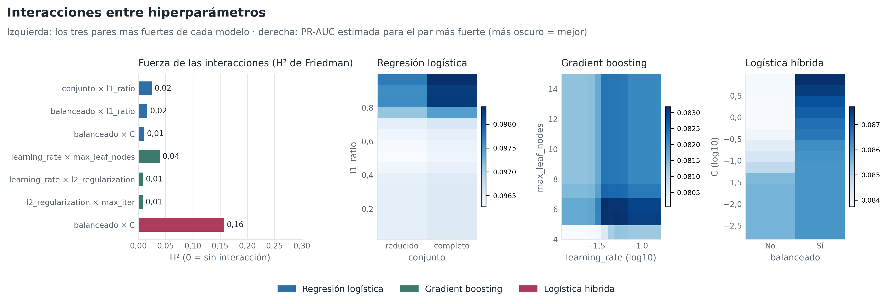

# Optimización de hiperparámetros (Workshop S5)

Este documento explica cómo se optimizaron los modelos, qué se obtuvo y qué se aprendió. Las cifras salen de la ejecución con datos reales del cuaderno `03_modelado` (01-oct-2026). El código está en `src/modeling.py`.

## 1. Diseño de la optimización

| Elemento | Decisión | Justificación |
|---|---|---|
| Herramienta | **Optuna 5**, muestreador TPE con semilla 42 | Búsqueda bayesiana eficiente y reproducible |
| Validación interna | Entrenar con **C2** y validar con **C3** | Respeta el orden temporal: el modelo nunca ve el futuro. C4 y C5 quedan fuera de la búsqueda |
| Función objetivo | **PR-AUC** (precisión promedio) en C3 | Con alrededor de 80 eventos por cohorte, Precision@k es muy ruidosa como objetivo. La PR-AUC resume el orden completo y es estable |
| Presupuesto | 60 trials por modelo (180 en total) | La mejor PR-AUC se estabiliza antes del trial 30 en los tres modelos (Figura 13) |
| Selección final | **Lift@k en C4** (desempate: PR-AUC), frente a las reglas D y D2 | La métrica principal del proyecto se mide en datos que no participaron en la búsqueda |
| Reentrenamiento | El mejor conjunto de hiperparámetros se reentrena con C2+C3 | Usa todos los datos de entrenamiento disponibles |

### Espacios de búsqueda
| Modelo | Hiperparámetros |
|---|---|
| Regresión logística (elastic-net, solver saga) | `C` ∈ [0,001; 10] (escala log), `l1_ratio` ∈ [0; 1], balanceo de clases (sí/no), conjunto de variables (completo / sin `curso`) |
| Gradient boosting (HistGradientBoosting, monotonía creciente en atrasos) | `learning_rate` ∈ [0,01; 0,2] (log), `max_depth` ∈ {2, 3, 4}, `max_leaf_nodes` ∈ [4; 15], `min_samples_leaf` ∈ [20; 120], `l2_regularization` ∈ [0,001; 10] (log), `max_iter` ∈ [50; 400], balanceo y conjunto de variables |
| Logística híbrida (D39, intento único) | `C` ∈ [0,001; 10] (log) y balanceo. Las variables son fijas: señales de D2 más variables académicas |

Los rangos son **conservadores a propósito**: árboles poco profundos, hojas grandes y regularización fuerte, porque hay pocos eventos (193 en el entrenamiento).

Los espacios y el número de pruebas (60 por modelo) están en `config.yaml` (`optimizacion`), de donde los leen la optimización (`modeling.entrenar_candidatos`) y el análisis de sensibilidad (`sensibilidad.ESPACIOS`). Se comprobó que, con la misma semilla, Optuna propone exactamente las mismas pruebas que cuando el espacio estaba escrito en el código (D59).

## 2. Resultados

### Hiperparámetros elegidos (datos reales)
| Modelo | Mejores hiperparámetros |
|---|---|
| Regresión logística | todas las variables, sin balanceo, `C` = 2,75, `l1_ratio` = 0,87 |
| Gradient boosting | todas las variables, con balanceo, `learning_rate` = 0,035, `max_depth` = 3, `max_leaf_nodes` = 6, `min_samples_leaf` = 101, `l2` = 4,25, `max_iter` = 359 |
| Logística híbrida | con balanceo, `C` = 9,0 (cerca del límite superior del rango, 10: casi sin regularización. La respuesta es casi plana en `C` —sección 2 bis—, así que ampliar el rango no cambiaría el resultado de forma apreciable) |

### Efecto de la optimización en C4 (métrica principal)
| Modelo | Antes de optimizar | Después de optimizar | Diagnóstico |
|---|---|---|---|
| Regresión logística | **1,53** (base de la Fase 1, valores por defecto) | 1,40 | Subajuste: PR-AUC 0,140 en entrenamiento y 0,113 en C4 |
| Gradient boosting | — (sin ejecución por defecto en C4; ver «antes y después» en la validación interna, sección 2 bis) | 1,06 | **Sobreajuste:** PR-AUC 0,245 en entrenamiento y 0,103 en C4 (brecha 0,14) |
| Logística híbrida | — | 1,53 | Estable: brecha 0,000 |
| *Referencia: regla D2* | — | *1,93* | — |

### Evolución de la búsqueda (validación interna C2 → C3, datos reales)

| Modelo | PR-AUC mínima | Mediana | Máxima (trial) | Llega cerca del máximo en |
|---|---|---|---|---|
| Regresión logística | 0,062 | 0,102 | **0,106** (52) | trial 5 |
| Gradient boosting | 0,067 | 0,084 | 0,089 (28) | trial 28 |
| Logística híbrida | 0,084 | 0,087 | 0,088 (10) | trial 3 |

*Referencia: la tasa de no matrícula de C3 es 0,062, que es la PR-AUC de un modelo sin capacidad de ordenar.*

**Lectura:**
- **La regresión logística** fue la que más mejoró con la búsqueda, de 0,062 a 0,106. Sus valores mínimos (0,062) corresponden a regularización muy fuerte (`C` < 0,02), que reduce el modelo a la tasa base. Los mejores trials usan poca regularización, mezcla L1/L2 alta, todas las variables y **sin balanceo** (mediana 0,102 frente a 0,095 con balanceo).
- **El gradient boosting** necesitó más trials (mejor en el 28) y prefiere hojas grandes (`min_samples_leaf` ≈ 100) y el conjunto completo (mediana 0,084 frente a 0,077 sin `curso`). Aun su mejor valor queda por debajo de la logística.
- **La logística híbrida** casi no cambia con `C` (0,084 a 0,088): sus variables son fijas y pocas. El balanceo ayuda (0,087 frente a 0,084).
- **El orden de los modelos cambió de C3 a C4:** en la validación interna ganó la logística regularizada (0,106), pero en C4 fue mejor la híbrida (Lift@k 1,53 frente a 1,40). Esta inestabilidad entre cohortes es la razón principal para seleccionar en una cohorte distinta (C4) y no confiar solo en la búsqueda.

Las figuras 14 a 16 del cuaderno `04_optimizacion` muestran cada trial, el efecto de `C`, del balanceo y del tamaño de hoja, y el paso de C3 a C4.

Archivo completo de los 180 trials: `results/metrics/optuna_historial_real.csv`. Contiene hiperparámetros y PR-AUC, sin datos de estudiantes.

## 2 bis. Análisis de sensibilidad de los hiperparámetros (D58)

El análisis parte del historial de Optuna ya guardado: 180 pruebas, cada una con sus hiperparámetros y la PR-AUC de la validación interna C2 → C3. Ese archivo no contiene datos de estudiantes, así que el análisis **no vuelve a entrenar ningún modelo ni usa C4 o C5**. Código: `src/sensibilidad.py` y `src/graficos_sensibilidad.py`. Para regenerarlo: `python tools/generar_sensibilidad.py --fuente real`. Tablas en `results/metrics/sensibilidad_*_real.csv`.

Métodos:
- **Importancia** por fANOVA, que descompone la varianza de la PR-AUC entre hiperparámetros con un bosque aleatorio (Hutter et al., 2014), y por disminución media de impureza. Ambas vienen de `optuna.importance` y se repiten con cinco semillas.
- **Dependencia parcial** sobre un modelo sustituto: un bosque aleatorio entrenado con las 60 pruebas de cada modelo. Muestra cómo cambia en promedio la PR-AUC al mover un hiperparámetro, dejando los demás como en las pruebas observadas.
- **Interacciones** con el estadístico H² de Friedman para cada par: qué parte de su efecto conjunto no se explica sumando los efectos por separado (0 = sin interacción). Se acompaña de la dependencia parcial 2D del par más fuerte.
- **Sensibilidad de uno a la vez:** desde la mejor prueba, cuánto cambia la PR-AUC estimada al recorrer todo el rango de cada hiperparámetro.

Con 60 pruebas por modelo y una validación de 81 eventos, el sustituto es aproximado: las cifras se leen como tendencias.

### Ranking de importancia

| Modelo | 1.º (fANOVA) | 2.º | Resto | Rango de PR-AUC al mover el 1.º (uno a la vez) |
|---|---|---|---|---|
| Regresión logística | `balanceado` 58 % | `C` 38 % | `l1_ratio` 3 %, `conjunto` 0 % | `C`: de 0,069 a 0,105 |
| Gradient boosting | `min_samples_leaf` 90 % | `balanceado` 4 % | los otros seis, ≤ 2 % cada uno | `min_samples_leaf`: de 0,073 a 0,087 |
| Logística híbrida | `balanceado` 98 % | `C` 2 % | — | `balanceado`: de 0,084 a 0,088 |

Las desviaciones entre semillas son pequeñas (≤ 0,011), así que el orden es estable. Los dos métodos coinciden en el gradient boosting y en la logística híbrida, pero **no en la regresión logística**. Por impureza, `C` explica el 86 % y `balanceado` el 7 %; la sensibilidad de uno a la vez también pone a `C` primero, con un rango seis veces mayor que el de `balanceado` (0,036 frente a 0,006). La lectura coherente con las tres medidas es que **`C` decide si el modelo funciona**: con `C` < 0,03 la regularización lo aplana hacia la tasa base. El balanceo ajusta el resultado dentro de la zona buena. fANOVA reparte la importancia sobre todo el espacio y le da más peso a una variable binaria que divide las pruebas en dos grupos.

### Dependencia parcial

- **Regresión logística.** La PR-AUC sube de 0,070 a 0,103 al pasar de `C` = 0,001 a `C` ≈ 1, y desde ahí se mantiene: una meseta. Sin balanceo es algo mejor (0,098 frente a 0,094). `l1_ratio` casi no influye (0,096 a 0,098). El valor elegido, `C` = 2,75, está dentro de la meseta.
- **Gradient boosting.** Hay un **escalón** en `min_samples_leaf`: con hojas de menos de unos 80 estudiantes la PR-AUC queda en 0,073, y con más sube a 0,083–0,085. Las hojas pequeñas memorizan casos (sobreajuste, sección 5). Los otros siete hiperparámetros mueven la PR-AUC menos de 0,002. El valor elegido, 101, está en la zona alta.
- **Logística híbrida.** La respuesta es casi plana: entre 0,084 y 0,088 en todo el espacio. Con balanceo es algo mejor, y `C` apenas cambia nada. Con sus pocas variables fijas, no hay mucho que ajustar.

### Interacciones

| Modelo | Par más fuerte | H² | Lectura |
|---|---|---|---|
| Regresión logística | `conjunto` × `l1_ratio` | 0,02 | Débil: los efectos se suman |
| Gradient boosting | `learning_rate` × `max_leaf_nodes` | 0,04 | Débil |
| Logística híbrida | `balanceado` × `C` | 0,16 | Moderada en proporción, pero sobre una variación muy pequeña: `C` solo importa algo cuando hay balanceo |

En la regresión logística y el gradient boosting **las interacciones son débiles**. Optimizar cada hiperparámetro casi por separado habría llegado a lo mismo, y no hay combinaciones ocultas que la búsqueda haya podido pasar por alto.

### Antes y después de la búsqueda (validación interna C2 → C3)

Las 10 primeras pruebas de Optuna son aleatorias (fase inicial del TPE) y sirven como «antes». La mejor prueba es el «después».

| Modelo | Primera prueba | Mediana de las 10 aleatorias | Mejor prueba (n.º) | Ganancia | Mejor frente al azar (0,062) |
|---|---|---|---|---|---|
| Regresión logística | 0,088 | 0,079 | **0,106** (52) | +0,027 | 1,70 veces |
| Gradient boosting | 0,080 | 0,075 | **0,089** (28) | +0,014 | 1,44 veces |
| Logística híbrida | 0,084 | 0,086 | **0,088** (10) | +0,002 | 1,41 veces |

La búsqueda **sí mejoró la validación interna**, sobre todo en la regresión logística (+34 % sobre la mediana aleatoria). Esa ganancia no se trasladó a C4: la regresión logística pasó de Lift@k 1,53 con valores por defecto a 1,40 optimizada (tabla de la sección 2). Es la misma conclusión de la sección 3: el límite es de señal y de estabilidad entre cohortes, no de hiperparámetros.

### Configuración final y justificación

| Modelo | Configuración elegida | Por qué es razonable según la sensibilidad |
|---|---|---|
| Regresión logística | `C` = 2,75, `l1_ratio` = 0,87, sin balanceo, todas las variables | Está en la meseta de `C` y del lado sin balanceo, que es el mejor. `l1_ratio` y el conjunto casi no influyen |
| Gradient boosting | `min_samples_leaf` = 101, `max_depth` = 3, `max_leaf_nodes` = 6, `learning_rate` = 0,035 | Las hojas grandes evitan la zona de sobreajuste. El resto casi no importa |
| Logística híbrida | `C` = 9,0, con balanceo | La respuesta es plana: cualquier `C` da lo mismo, y el balanceo es lo único que cambia algo |

**Lección para el proyecto:** los hiperparámetros que importan son los que controlan la capacidad del modelo, como la regularización `C` y el tamaño mínimo de hoja. Ninguno, en ningún valor, permite a los modelos superar a la regla D2 en C4. La optimización hizo su trabajo dentro de lo que los datos permiten.

## 3. Análisis: ¿por qué la optimización no mejoró la priorización?

1. **La señal es débil y cambia entre años.** La tasa de no matrícula varía de 6,2 % a 11,1 % según la cohorte, y las correlaciones univariadas son menores a 0,07. Lo que funcionó mejor en C3, que solo tiene 81 eventos, no se trasladó a C4. Optimizar sobre una sola cohorte pequeña ajusta parte del ruido.
2. **El modelo de árboles memoriza.** Aun con restricciones fuertes y monotonía, duplica su PR-AUC en entrenamiento sin ganar nada en C4: es el patrón típico de **sobreajuste** visto en la actividad de la semana 3.
3. **Los modelos lineales se quedan cortos.** Tienen brecha pequeña pero rendimiento bajo en entrenamiento: **subajuste**, causado por la falta de información en los datos y no por falta de capacidad del modelo.
4. **La regla D2 incorpora conocimiento del dominio.** Ordena por jerarquía: un pago anterior tardío pesa más que cualquier número de atrasos. Ese orden lexicográfico no lo aprendió un modelo entrenado con pocos eventos.

## 4. Mejoras que sí aportó el proceso

- **Se evitó un sobreajuste no detectado.** Sin la comparación con C4, el gradient boosting habría parecido el mejor modelo por su desempeño en entrenamiento.
- **Se ganó calibración.** La logística, con Platt en C4, entrega probabilidades confiables (Brier 0,0648, igual a la tasa histórica), mientras que el modelo sin calibrar tenía un Brier de 0,22.
- **Las decisiones quedaron registradas.** Se probó un solo intento adicional, registrado antes de verlo (D39). Así se evitó probar variantes hasta que alguna gane por azar sobre C4.
- **Se confirmó la regla fuera de muestra.** En C5, D2 obtuvo Lift@k = 1,97 [1,24; 2,56], y el mejor modelo, 0,98.

## 5. Diagnóstico detallado de sobreajuste y subajuste (actividad de la semana 3)
El análisis completo está en el cuaderno [`overfitting_analysis.ipynb`](../notebooks/overfitting_analysis.ipynb) y en el reporte [`diagnostic_report.pdf`](diagnostic_report.pdf). Amplía la tabla de ajuste de la sección 2 con:

| Componente | Qué se hizo | Código |
|---|---|---|
| Seguimiento de métricas | Pérdida y PR-AUC de entrenamiento y validación en cada iteración del gradient boosting y en cada iteración del optimizador de las regresiones logísticas; `learning_curve` y `validation_curve` de scikit-learn para los tres modelos | `src/diagnostico.py` |
| Curvas de aprendizaje | A (pérdida sin ponderar, con escala común en los modelos de la Fase 2 y una referencia sin modelo) y B (PR-AUC) durante el entrenamiento; C por tamaño del entrenamiento; D por hiperparámetro (incluye el control sobrerregularizado). 300 DPI, con anotaciones | `src/graficos_diagnostico.py` |
| Diagnóstico cuantitativo | Brecha relativa de PR-AUC (sobreajuste si supera 30 %) y mejora sobre el azar (subajuste si no llega a 1,5 veces). Segunda etapa (D54): un subajuste se nombra «subajuste (falta capacidad)» si con más capacidad la validación sube al menos 0,005, «subajuste (faltan datos)» si solo ayudan más datos y «límite de señal» si no ayuda ninguna de las dos. Umbrales en `config.yaml` | `diagnosticar`, `refinar_diagnostico`, `resumen_seguimiento` |
| Estrategias con antes/después | Cada una cambia una sola cosa de un modelo de la Fase 2 que tiene el problema (D54). Contra el sobreajuste: E1 L2 ×10, E2 parada temprana, E3 árboles más pequeños. Contra el subajuste: E4a solo variables de D2, E4b solo hiperparámetros del híbrido, E5 menos regularización, E6 interacciones. Más una fila de referencia (control → Fase 2) y una contraprueba (más iteraciones). Veredicto con IC 95 % bootstrap por familia, réplica C2 → C3 y cinco semillas | `plan_estrategias`, `evaluar_estrategias`, `veredicto_estrategia` |

Reglas del análisis: **C5 no interviene**, las particiones respetan el orden temporal y lo que una estrategia debe elegir (las iteraciones de la parada temprana) se decide en la validación interna, no en C4. Dos modelos de control, uno que sobreajusta y otro que subajusta, comprueban que las reglas reconocen los casos claros. Este análisis no cambia la decisión final (regla D2).

Los umbrales son reglas prácticas, no pruebas estadísticas. Se fijaron el 02-oct-2026, antes de ejecutar el cuaderno con datos reales, pero cuando ya se conocían las PR-AUC de entrenamiento y de C4 de la Fase 2. Esta regla es más completa que la de la tabla de la sección 2 (brecha absoluta mayor que 0,10; entrenamiento menor que 0,15) y puede diferir de ella en casos límite.

### Resultados con datos reales (C2+C3 → C4), versión revisada (D54)

| Modelo | PR-AUC entrenamiento | PR-AUC C4 | Brecha relativa | Veces el azar en C4 | Más capacidad | Lift@k | Diagnóstico |
|---|---|---|---|---|---|---|---|
| Regresión logística | 0,140 | 0,113 | 19 % | 1,28 | 0,000 | 1,40 | Límite de señal |
| Gradient boosting | 0,245 | 0,103 | 58 % | 1,17 | — | 1,06 | **Sobreajuste** |
| Logística híbrida | 0,126 | 0,125 | 0 % | 1,41 | 0,000 | 1,53 | Límite de señal |
| Control: árboles sin regularizar | 0,998 | 0,088 | 91 % | 0,99 | — | 1,00 | Sobreajuste |
| Control: logística sobrerregularizada | 0,076 | 0,089 | −17 % | 1,00 | +0,016 | 1,06 | Subajuste (falta capacidad) |

«Más capacidad»: cambio de la mejor PR-AUC de validación con un C mayor que el actual (curva D). En la primera etapa las dos logísticas eran «subajuste»; la segunda etapa las separa del control, que sí mejora con más capacidad. Más datos tampoco ayudan de forma concluyente (+0,004 y +0,002 entre la mitad y el total, menos que la variación entre submuestras).

Lo que mostraron las curvas:

- **Gradient boosting.** La pérdida ponderada de validación (la que minimiza el modelo) es mínima en la primera iteración (0,694) y sube a 0,792 en las 359 iteraciones de la Fase 2. La sin ponderar baja (0,692 → 0,580) porque corrige la inflación de probabilidades de un modelo balanceado; por eso la figura A muestra las dos. La PR-AUC de validación se queda cerca de 0,10 (máximo 0,112 en la iteración 526) mientras la de entrenamiento sigue subiendo.
- **Regresiones logísticas.** Las curvas se aplanan casi de inmediato y terminan juntas. La regresión logística queda a la altura de no tener modelo en pérdida sin ponderar (0,307 frente a 0,301).
- **Hiperparámetros.** El valor que eligió Optuna queda cerca del máximo de validación en los tres modelos; en las logísticas, aumentar C hasta 100 no cambia la validación.

| Estrategia (cambia una sola cosa) | PR-AUC C4 | Diferencia [IC 95 %] | Réplica C2 → C3 | Brecha | Lift@k | Veredicto |
|---|---|---|---|---|---|---|
| E1 · L2 ×10 (gradient boosting) | 0,103 → 0,107 | +0,003 [−0,004; +0,015] | −0,009 | 0,141 → 0,108 | 1,06 → 1,13 | Sin diferencia demostrable |
| E2 · Parada temprana (359 → 20) | 0,103 → 0,095 | −0,009 [−0,033; +0,010] | −0,008 | 0,141 → 0,080 | 1,06 → 0,80 | Sin diferencia demostrable |
| E3 · Árboles más pequeños | 0,103 → 0,106 | +0,002 [−0,008; +0,017] | −0,008 | 0,141 → 0,098 | 1,06 → 0,80 | Sin diferencia demostrable |
| E4a · Solo variables de D2 | 0,113 → 0,120 | +0,007 [−0,016; +0,037] | −0,022 | 0,026 → 0,013 | 1,40 → 1,33 | Sin diferencia demostrable |
| E4b · Solo hiperparámetros del híbrido | 0,120 → 0,125 | +0,005 [−0,001; +0,013] | +0,004 | 0,013 → 0,000 | 1,33 → 1,53 | Sin diferencia demostrable |
| E5 · C ×10 (regresión logística) | 0,113 → 0,113 | 0,000 [−0,001; +0,001] | 0,000 | 0,026 → 0,027 | 1,40 → 1,46 | Sin diferencia demostrable |
| E6 · Interacciones (logística híbrida) | 0,125 → 0,127 | +0,002 [−0,032; +0,040] | −0,004 | 0,000 → 0,100 | 1,53 → 1,53 | Sin diferencia demostrable |
| Referencia · control → Fase 2 | 0,088 → 0,103 | +0,015 [−0,003; +0,044] | +0,018 | 0,910 → 0,141 | 1,00 → 1,06 | Sin diferencia demostrable |
| Contraprueba · 359 → 718 iteraciones | 0,103 → 0,105 | +0,002 [−0,008; +0,015] | +0,002 | 0,141 → 0,183 | 1,06 → 0,86 | Sin diferencia demostrable |

Con la regla fijada antes de repetir (D54: cambio ≥ 0,005, IC 95 % bootstrap por familia sin el cero, réplica y cinco semillas en el mismo sentido), **ninguna estrategia mejora ni empeora la PR-AUC de forma demostrable**. Las tres contra el sobreajuste reducen la brecha sin mejorar la validación. E6 confirma el límite de señal: con interacciones, la PR-AUC de entrenamiento de la híbrida sube de 0,126 a 0,227 y la de C4 casi no cambia, y el modelo pasa a sobreajustar. La mejora que la primera versión atribuía a E4 (0,113 → 0,125) queda, separada en dos pasos, dentro del ruido. El mejor modelo llega a un Lift@k de 1,53 en C4, por debajo del 1,93 de la regla D2, así que la decisión final no cambia.

El reporte se regenera con `python tools/generar_reporte_diagnostico.py --fuente real` después de ejecutar el cuaderno. Las tablas y figuras salen de los resultados guardados y el análisis escrito está en `docs/diagnostic_report_narrativa_real.json`; una prueba automática comprueba que cada cifra citada en ese análisis exista en los resultados.

## 6. Trabajo futuro
- **Validación cruzada temporal con más cohortes** (2027 en adelante): con cada ciclo nuevo habrá más eventos para optimizar con menos ruido.
- **Variables nuevas** con más señal: interacción con Secretaría, puntualidad mes a mes y motivos de no matrícula (con consentimiento).
- **Optimizar directamente Lift@k** con varias ventanas temporales cuando haya al menos 3 cohortes de validación.

## Referencias

- Akiba, T., Sano, S., Yanase, T., Ohta, T. y Koyama, M. (2019). Optuna: A next-generation hyperparameter optimization framework. *KDD 2019*.
- Hutter, F., Hoos, H. y Leyton-Brown, K. (2014). An efficient approach for assessing hyperparameter importance. *ICML 2014* (fANOVA).
- Friedman, J. H. y Popescu, B. E. (2008). Predictive learning via rule ensembles. *The Annals of Applied Statistics*, 2(3) (estadístico H de interacción).
- Friedman, J. H. (2001). Greedy function approximation: a gradient boosting machine. *The Annals of Statistics*, 29(5) (dependencia parcial).
